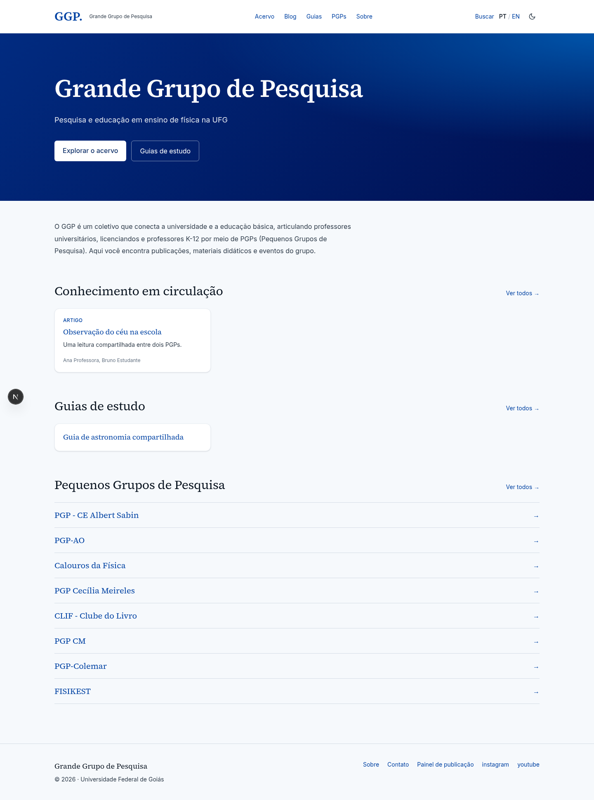
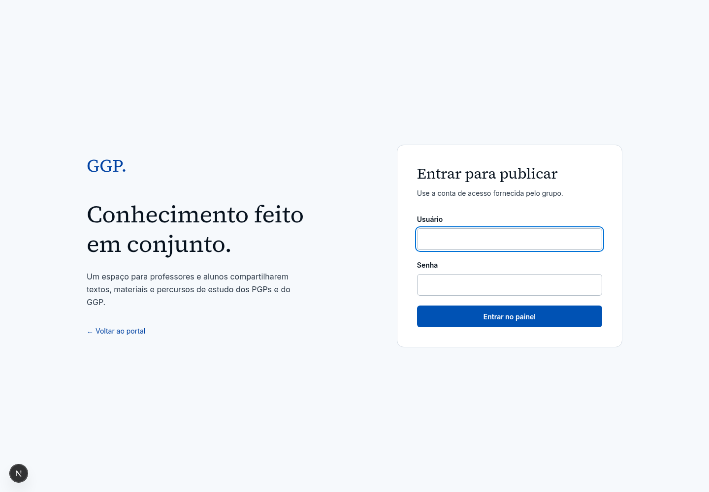
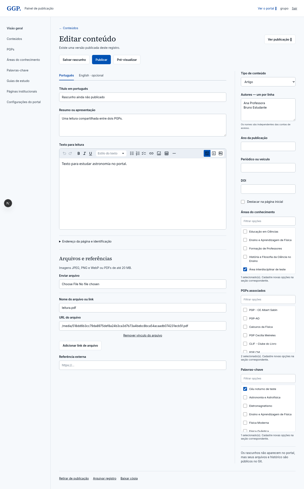

# Telas do portal GGP

Capturas reais da versão implementada, produzidas durante a validação local com dados de teste. Os exemplos de artigo, autores, PGPs e guia usados nos testes não foram adicionados ao acervo inicial. O aviso de modo local e o indicador de desenvolvimento pertencem ao ambiente de teste.

Abra os arquivos abaixo para visualizar as imagens completas:

| Tela | Desktop | Celular | Tema escuro |
|---|---|---|---|
| Portal | [Abrir](screenshots/portal-desktop.png) | [Abrir](screenshots/portal-mobile.png) | [Abrir](screenshots/portal-dark.png) |
| Login | [Abrir](screenshots/login-desktop.png) | [Abrir](screenshots/login-mobile.png) | — |
| Painel | [Abrir](screenshots/admin-desktop.png) | [Abrir](screenshots/admin-mobile.png) | — |
| Editor | [Abrir](screenshots/editor-desktop.png) | [Abrir](screenshots/editor-mobile.png) | [Abrir](screenshots/editor-dark.png) |

## Portal

## Login

## Editor

